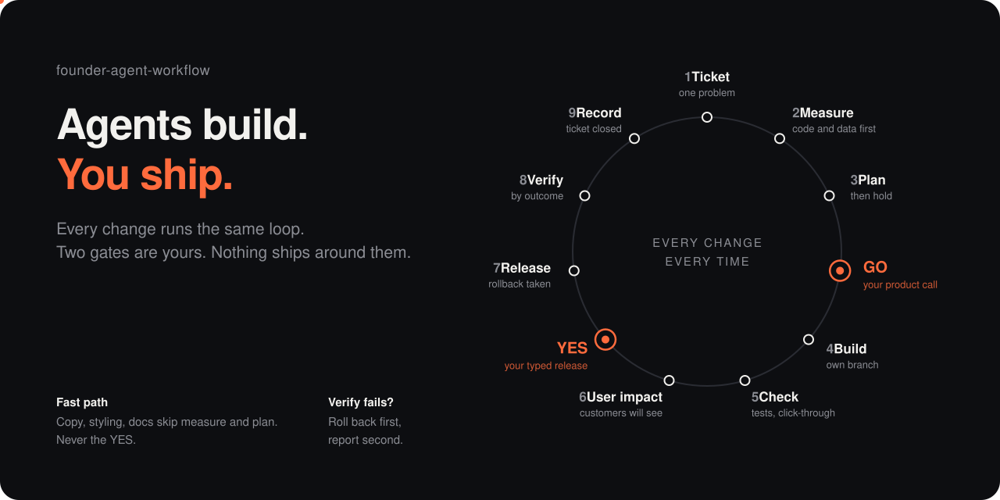

# founder-agent-workflow

**Build and run a real product alone. You decide, Claude Code agents do the work, and nothing ships without your yes.**



Agents write code fast now. The hard part is everything around it: knowing what they changed, checking it actually works, and making sure nothing reaches your users before you've said yes. This skill sets that up for you, sized to where your project is, and then runs it with you.

It comes from building and running [Wingmen](https://flywingmen.com), a B2B SaaS with paying customers, solo with Claude Code. Every rule in it exists because something broke.

## Rules that cost something

A few of them, and what taught them:

- **Check outcomes, not exit codes.** A seed script exited cleanly having written nothing, and every check after it trusted it.
- **Unknown is never a no.** A filter treated missing data as a reject and quietly threw away good records for four days.
- **One worktree per agent.** Two agents in one folder broke each other's test run.
- **Break your own fix on purpose.** Two tests passed by matching a logged command instead of what actually ran. Breaking the fix showed it.
- **Test keys never share a wallet with production.** One test run emptied the model account and took the product's AI down for two hours.
- **Automations that delete need an age floor.** A cleanup job deleted a new customer's own records five hours after they connected their account.
- **A fresh agent tests as a stranger.** A page passed every test and was rejected in seconds, because the agents who built it knew how it was meant to work.

The full set is in [`references/doctrine.md`](references/doctrine.md).

## What it does

Give it to your Claude, say what you're building, and it will:

1. Ask seven short questions: your product, your users, how you deploy, how you roll back, where you track work.
2. Pick your stage, and set up only what that stage needs.
3. Write the rules, templates and release gate into your repo.
4. Take your first real change through the whole loop with you.

| Stage | When | You get |
|---|---|---|
| 1. Solo loop | Before launch | Plan before build, one click-through, a typed yes before production, a rollback, agents without production keys |
| 2. Live product | Real users or money | CI on the exact commit, release windows, deploys only when you trigger them, blind QA, screens checked with heavy and empty data |
| 3. Parallel lanes | More work than one agent can carry | An orchestrator plus named agents in their own worktrees, handovers, overnight work ([how to run lanes](references/lanes.md)) |

## Install

Claude Code, for all your projects:

```
git clone https://github.com/flywingmen/founder-agent-workflow ~/.claude/skills/founder-agent-workflow
```

Claude Code, for one project: clone it into `.claude/skills/founder-agent-workflow` in that repo.

Claude.ai: download this repo as a zip and upload it under Settings, Capabilities, Skills. There it runs the interview and gives you the filled files to download; the build loop itself runs in Claude Code.

Then tell Claude what you're building and that you want to ship it with agents.

For browser checks you'll want Playwright (`npm i -D playwright && npx playwright install chromium`) or a browser MCP server. The skill sets this up with you.

## What's inside

- `SKILL.md`: the interview, the stages, the change loop, the fast path, the hard rules.
- `references/doctrine.md`: the full rules, including how checking works when agents write the code.
- `references/backlog.md`: the tracker engine: one inbox for ideas, requests and bugs, weekly triage, priorities, epics, linking and merging tickets (Linear, GitHub Issues or a file).
- `references/release-lock.md`: how to make sure only you can ship, on any GitHub plan.
- `references/lanes.md`: how to open and run parallel agent lanes in Claude Code.
- `templates/`: project rules, design rules (`design.md`), triage, founder-triggered deploy with a green-CI check (`deploy-workflow.yml`), permission backup (`settings.json`), ticket, plan, release checklist, "Customers will see", QA journeys, handover, lane brief, traps.

## What it won't do

It won't tell you what to build, and it won't find you users. It keeps the building safe and out of your way so your time goes to those.

## License

MIT
